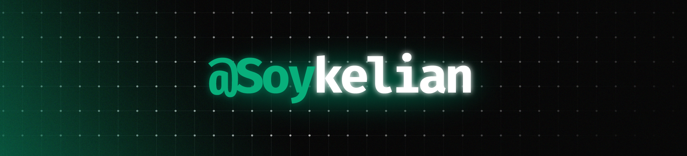

# ¡Hola! 👋 Soy Kelian

### Estudiante de Ingeniería de Software · Creador de proyectos

Aprendo construyendo: exploro ideas y las convierto en proyectos.

---

## 🧰 Tech Stack

 

## 📊 GitHub Analytics

## 📈 Contribution Graph

## 🗂️ Proyectos destacados

- 📚 [Biblioteca](https://github.com/soykelian/bibilioteca) — proyecto Java sobre herencia y polimorfismo.
- 🧵 [Excepciones e hilos](https://github.com/soykelian/Semana08_Excepciones_Hilos) — simulación de operaciones bancarias concurrentes.
- 📦 [CRUD de inventario](https://github.com/soykelian/CRUD_MagnusSIS) — gestión de productos con operaciones CRUD.
- 🏟️ [Sistema de gestión de tutorías](https://github.com/soykelian/sistema-gestion-tutorias-fet) — proyecto en TypeScript.
- 🛍️ [Interfaz de sistema de inventario](https://github.com/soykelian/proyecto-aula-Front-sistema-inventario) — propuesta para una marca deportiva.

<h2 align="center">trust the process</h2>

*Gracias por visitar mi perfil. ✨*

